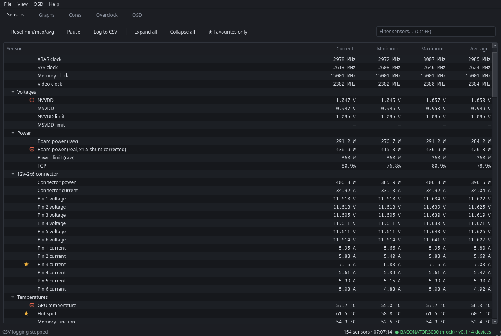

# meat³

A hardware monitor, on-screen display and overclocking tool for Linux, in the spirit of HWiNFO.

A root daemon (`meat3d`) reads the sensors and applies overclocking settings. Front ends talk to it
over a Unix socket:

- `meat3`: Qt desktop app
- `meat3-tui`: terminal UI, works over SSH
- `meat3-web`: optional read-only web UI with Prometheus metrics

Hardware is detected at start-up. Nothing needs configuring before first use.



## Hardware support

| Hardware | Monitoring | Tuning |
|---|---|---|
| NVIDIA GPUs (NVML) | Clocks, voltages, power, temperatures incl. GDDR7, limiters, fans, PCIe | Power limit, core/memory offsets, clock lock |
| AMD GPUs (amdgpu) | Everything in `gpu_metrics`, hwmon and sysfs; extra RDNA4 data | Power cap, performance level, Overdrive |
| AMD Ryzen CPUs (Zen 2–5) | Per-core clocks, power, voltage, C-states; FCLK/UCLK/MCLK; L3 use and hit rate; DRAM bandwidth; pipeline stalls | cpufreq, amd-pstate, Curve Optimizer, PBO limits |
| Other CPUs (Intel, older AMD) | cpufreq, usage, C-states, temperatures, RAPL power | cpufreq |
| Motherboard | Super I/O fans, voltages and temperatures; DDR5 SPD temperatures | – |
| Storage | NVMe temperatures, health and throughput; SATA temperature and SMART | – |
| Network | Per-interface bandwidth, link speed, errors, Wi-Fi signal; TCP retransmits | – |

Developed and tested on:
- an RTX 5080 with a Ryzen 7 9800X3D;
- an RX 9070 XT (monitoring only).

Other hardware should work wherever the kernel exposes the data. What's covered in detail is in
[docs/sensors.md](docs/sensors.md).

## Install

Arch and CachyOS are the main targets. Debian and Fedora are best-effort.

```sh
git clone https://github.com/warrenhall-cilix/meat3.git
cd meat3
./packaging/install.sh
```

Log out and back in once (the installer adds you to the `meat3` group), then run `meat3`.

For a server without a desktop: `./packaging/install.sh --headless --web`.

Installer options, optional kernel modules, updating and uninstalling are covered in
[docs/install.md](docs/install.md).

## Documentation

| | |
|---|---|
| [Install](docs/install.md) | Installer options, optional modules, updates, uninstall |
| [Using meat³](docs/usage.md) | Desktop app, TUI, themes, graphs |
| [Sensors](docs/sensors.md) | What is read on each device and where it comes from |
| [OSD](docs/osd.md) | Hotkey, desktop overlay, in-game display with MangoHud |
| [Overclocking](docs/overclocking.md) | Controls, permissions, safety guards, `meat3-cotune`, CPU binning with `meat3-bin` |
| [RX 9070 / 9070 XT](docs/rdna4.md) | RDNA4 hidden metrics, VRM tools, `meat3-gputune`, `meat3-skutable` |
| [Web UI and Prometheus](docs/web.md) | Read-only browser view, `/metrics`, Grafana dashboard |
| [Configuration](docs/configuration.md) | Every key in `/etc/meat3/config.json` |
| [Development](docs/development.md) | Layout, mock daemon, tests, writing a backend |
| [Daemon protocol](PROTOCOL.md) | Socket requests and responses |

## Safety

Overclocking settings can crash or damage hardware. meat³ applies these limits:
- **Range checks:** every control is checked by the daemon before it's applied.
- **Permissions:** only root and members of `meat3` can change anything.
- **Guards:** a few built-in guards cut power when a temperature or connector current goes too
  high. These are listed in [docs/overclocking.md](docs/overclocking.md#safety-guards).
- **Nothing is persistent:** settings are lost at reboot unless you save them as a profile or apply
  them at boot.

**Shunt-modded NVIDIA cards** under-report board power. Set the correction factor in
`nvidia_shunt_factor` (see [configuration](docs/configuration.md)) so that the "Board power
(real)" reading is correct.
